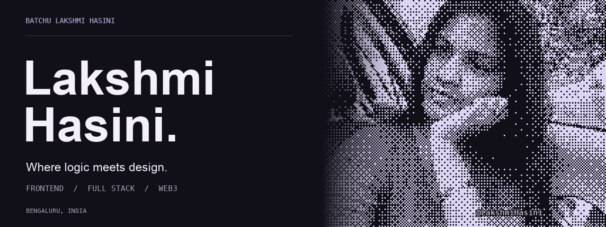
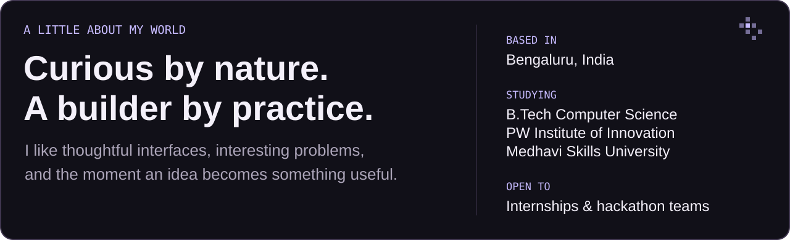
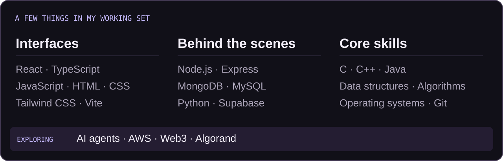
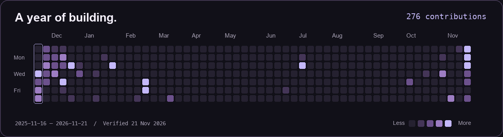
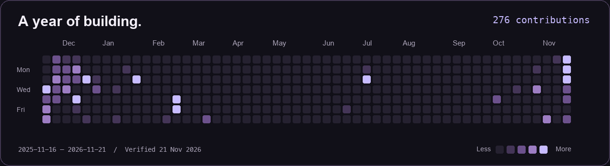
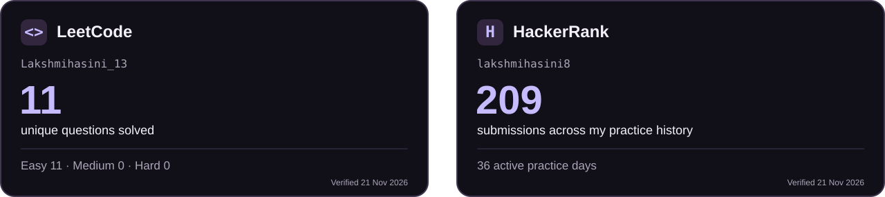

<picture>
  <source media="(prefers-reduced-motion: reduce)" srcset="assets/dither-banner.png">
  
</picture>

  <b>B.Tech CS student · Frontend developer · Hackathon builder</b> 
  Bengaluru, India · Open to frontend and software engineering internships

  <a href="https://lakshmihasini.in/">Portfolio</a> &nbsp;·&nbsp;
  <a href="https://www.linkedin.com/in/batchu-lakshmi-hasini-09b092318/">LinkedIn</a> &nbsp;·&nbsp;
  <a href="https://leetcode.com/u/Lakshmihasini_13/">LeetCode</a> &nbsp;·&nbsp;
  <a href="https://www.hackerrank.com/profile/lakshmihasini8">HackerRank</a>

---

## A little introduction

<picture>
  <source media="(max-width: 1100px)" srcset="assets/about-mobile.svg">
  
</picture>

More about me

I'm **Batchu Lakshmi Hasini**, studying Computer Science at **PW Institute of Innovation · Medhavi Skills University**. I enjoy turning a complex problem into an interface that feels simple, responsive, and useful.

I build across the frontend and backend, practise data structures and algorithms, and explore AI and blockchain through hands-on projects. Hackathons are where I get to bring those interests together with a team and ship an idea.

- **I care about:** thoughtful interfaces, clear code, and software that helps people.
- **I work with:** React, TypeScript, Node.js, and the fundamentals underneath them.
- **I'm open to:** internships, collaborations, and interesting hackathon teams.

## My toolkit

<picture>
  <source media="(max-width: 1100px)" srcset="assets/toolkit-mobile.svg">
  
</picture>

Skills as text

**Languages** &nbsp; `C` `C++` `Java` `JavaScript` `TypeScript` `Python`

**Frontend** &nbsp; `React` `HTML` `CSS` `Tailwind CSS` `Vite` `Responsive design`

**Backend & data** &nbsp; `Node.js` `Express` `MongoDB` `MySQL` `Supabase`

**Exploring through projects** &nbsp; `AWS` `AI agents` `Blockchain` `Algorand` `Smart contracts`

**Foundations** &nbsp; `Data structures` `Algorithms` `Operating systems` `Git & GitHub`

## Things I've built

### SevaRecover

An AI-powered platform that helps people understand failures in public-service applications and find practical recovery steps, with an agent backend on AWS.

`React` `TypeScript` `Tailwind CSS` `Python` `AWS Strands` `OpenSearch`

[Source code](https://github.com/LakshmiHasini/SevaRecover) · [Live demo](https://frontend-pink-two-8nh56blhuw.vercel.app)

### Recall

An incident investigation workspace that draws on previous reports and verified resolutions using Hindsight memory, keeping the supporting evidence visible.

`React` `TypeScript` `Cloudflare D1` `Hindsight`

[Source code](https://github.com/LakshmiHasini/recall-incident-intelligence) · [Live app](https://recall-incident-memory.lakshmihasini8.chatgpt.site)

### JobFit Lab

A career preparation workspace that connects job requirements to project evidence, preparation tasks, resume review, and interview practice.

`React` `TypeScript` `Node.js` `Express` `MongoDB`

[Source code](https://github.com/LakshmiHasini/JobFit-Lab)

### ChainMatrix · team project

A decentralised marketplace for freight shipping and freelancing on Flare, with smart-contract escrow, live pricing, and gasless onboarding.

`React` `Node.js` `Express` `Supabase` `Flare`

[Team repository](https://github.com/iamksr05/chain-matrix) · [Live demo](https://chain-matrix.vercel.app/)

<b>A few more builds</b>

- **[Campus Voting dApp](https://github.com/LakshmiHasini/sairam)** — a campus election hackathon build using Python, Algorand, and AlgoKit. [Live demo](https://sairam-new-psi.vercel.app)
- **[Event Management System](https://github.com/LakshmiHasini/IBM-Event-Management-System)** — event creation, registrations, and an organiser dashboard. [Live demo](https://ibm-event-management-system.vercel.app)
- **[My portfolio](https://github.com/LakshmiHasini/portfolio-website)** — the home for my projects, skills, and story. [Visit](https://lakshmihasini.in/)

[Explore all my repositories](https://github.com/LakshmiHasini?tab=repositories)

## A little progress, every day

<a href="https://github.com/LakshmiHasini?tab=overview">
  <picture>
    <source media="(prefers-reduced-motion: reduce)" srcset="assets/github-activity.png">
    
  </picture>
</a>

Prefer a still image?

## Problem-solving practice

<picture>
  <source media="(max-width: 1100px)" srcset="assets/coding-practice-mobile.svg">
  
</picture>

LeetCode counts unique solved questions. HackerRank shows submissions and active days; repeated attempts can count more than once.

[LeetCode questions](https://leetcode.com/u/Lakshmihasini_13/) · [HackerRank profile](https://www.hackerrank.com/profile/lakshmihasini8) · [HackerRank solutions I've shared](https://github.com/LakshmiHasini/HackerRank) · [My Hackos activity](https://www.hackerrank.com/lakshmihasini8/hackos/page/1)

Each image shows when its data was last verified.

## Let's build something useful

Have an internship opportunity, a project idea, or a hackathon team in mind? I'd love to connect.

[Message me on LinkedIn](https://www.linkedin.com/in/batchu-lakshmi-hasini-09b092318/) · [Visit my portfolio](https://lakshmihasini.in/)

---

Logic meets design. Build, learn, repeat.

