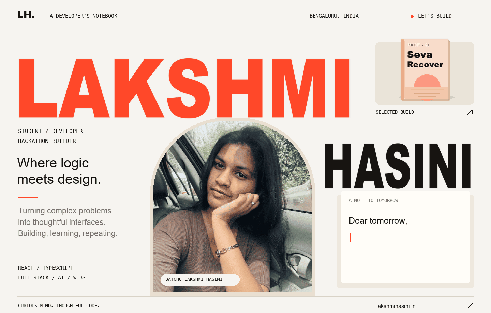
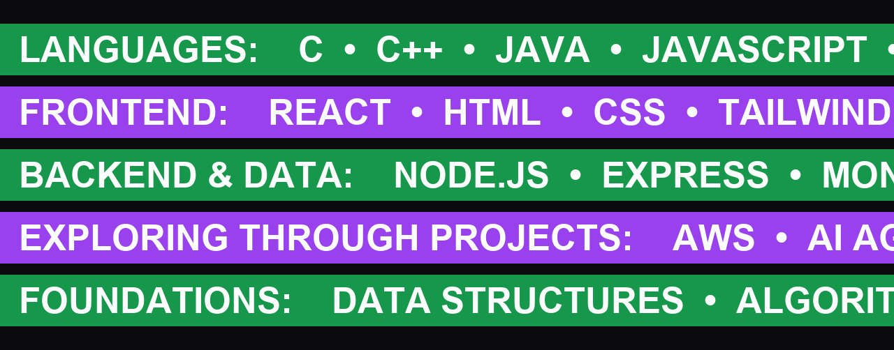
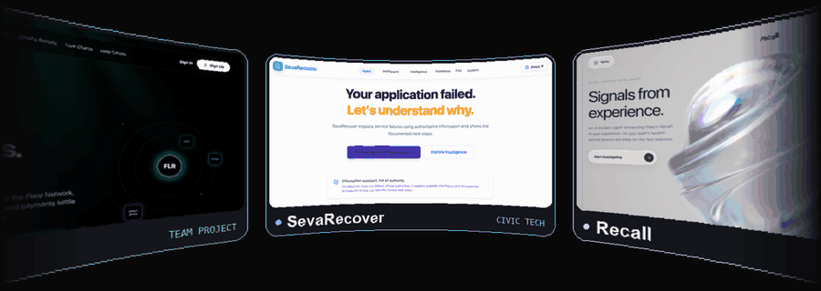
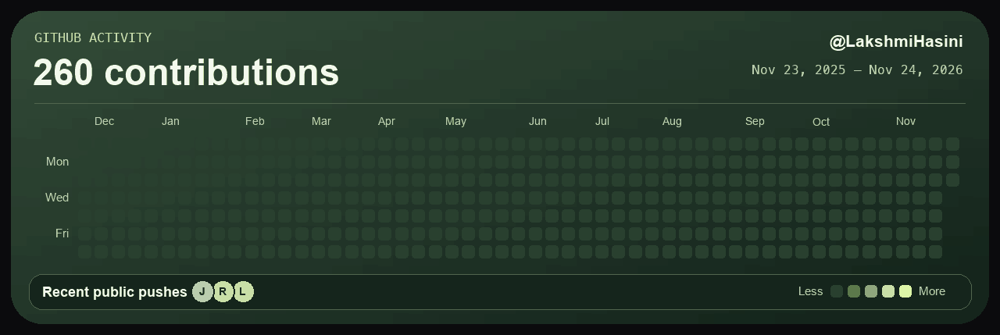
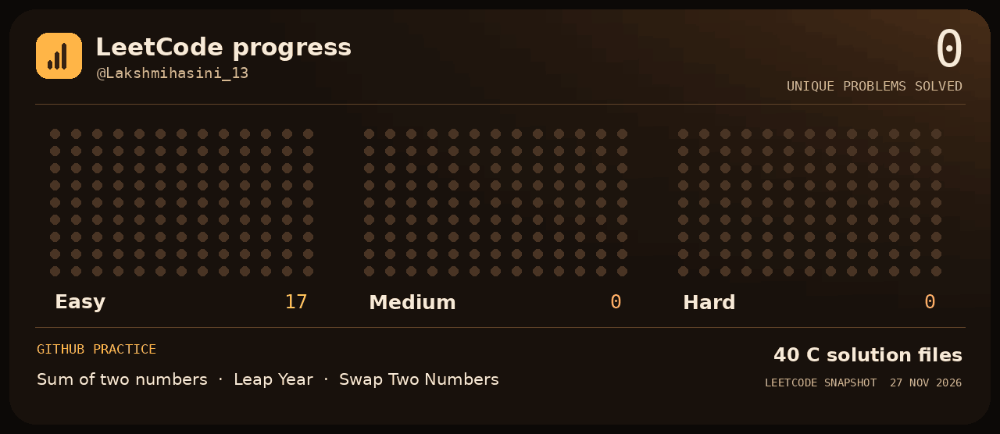
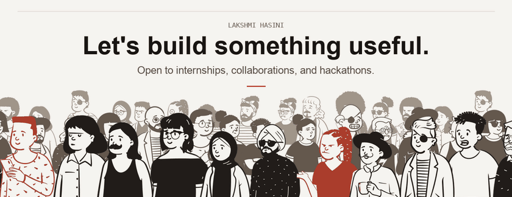

<a href="https://lakshmihasini.in/">
  <picture>
    <source media="(prefers-reduced-motion: reduce)" srcset="assets/editorial-hero.png">
    
  </picture>
</a>

<picture>
  <source media="(prefers-reduced-motion: reduce)" srcset="assets/math-scramble.png">
  
</picture>

<h2>
  
  <picture>
    <source media="(prefers-reduced-motion: reduce)" srcset="assets/headings/my-toolkit.png">
    
  </picture>
</h2>

<picture>
  <source media="(prefers-reduced-motion: reduce)" srcset="assets/toolkit-marquee.png">
  
</picture>

<h2>
  
  <picture>
    <source media="(prefers-reduced-motion: reduce)" srcset="assets/headings/things-ive-built.png">
    
  </picture>
</h2>

<picture>
  <source media="(prefers-reduced-motion: reduce)" srcset="assets/project-reel.png">
  
</picture>

<h2>
  
  <picture>
    <source media="(prefers-reduced-motion: reduce)" srcset="assets/headings/github-activity.png">
    
  </picture>
</h2>

<a href="https://github.com/LakshmiHasini?tab=overview">
  <picture>
    <source media="(prefers-reduced-motion: reduce)" srcset="assets/github-activity-card.png">
    
  </picture>
</a>

<h2>
  
  <picture>
    <source media="(prefers-reduced-motion: reduce)" srcset="assets/headings/leetcode-progress.png">
    
  </picture>
</h2>

<a href="https://leetcode.com/u/Lakshmihasini_13/">
  <picture>
    <source media="(prefers-reduced-motion: reduce)" srcset="assets/leetcode-matrix.png">
    
  </picture>
</a>

<h2>
  
  <picture>
    <source media="(prefers-reduced-motion: reduce)" srcset="assets/headings/lets-connect.png">
    
  </picture>
</h2>

<!-- Crowd Canvas adapted from Skiper UI (https://skiper-ui.com/v1/skiper39). Illustrations by Pablo Stanley's Open Peeps (https://www.openpeeps.com/). -->
<a href="https://www.linkedin.com/in/batchu-lakshmi-hasini-09b092318/">
  <picture>
    <source media="(prefers-reduced-motion: reduce)" srcset="assets/crowd-footer.png">
    
  </picture>
</a>
